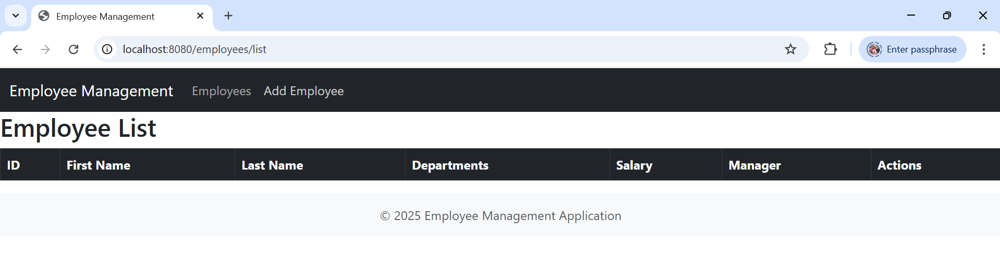
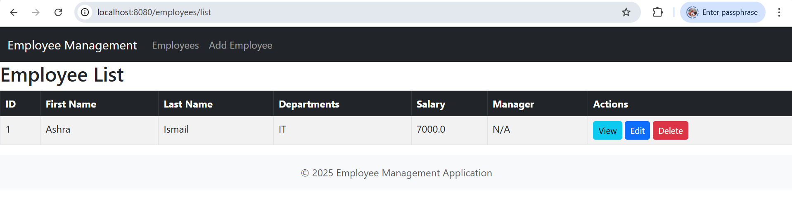
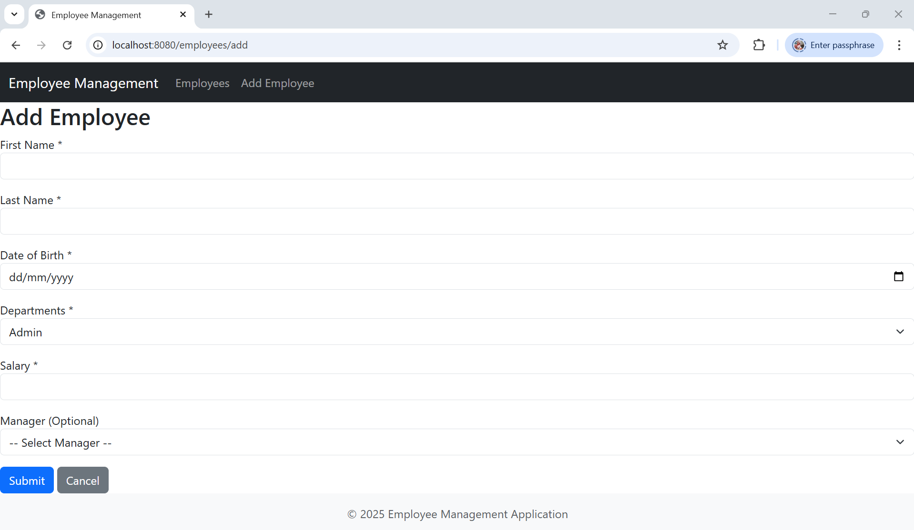
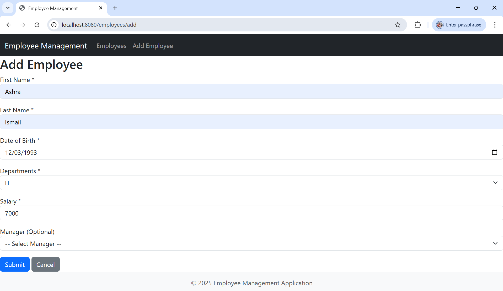
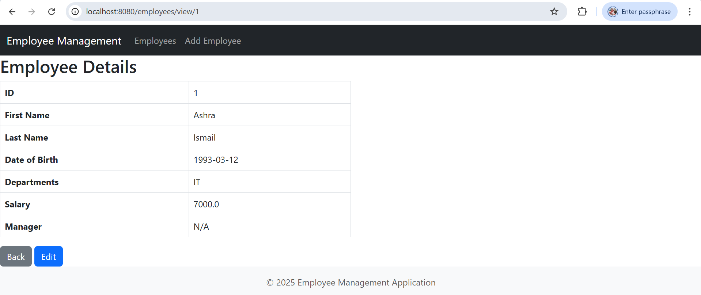
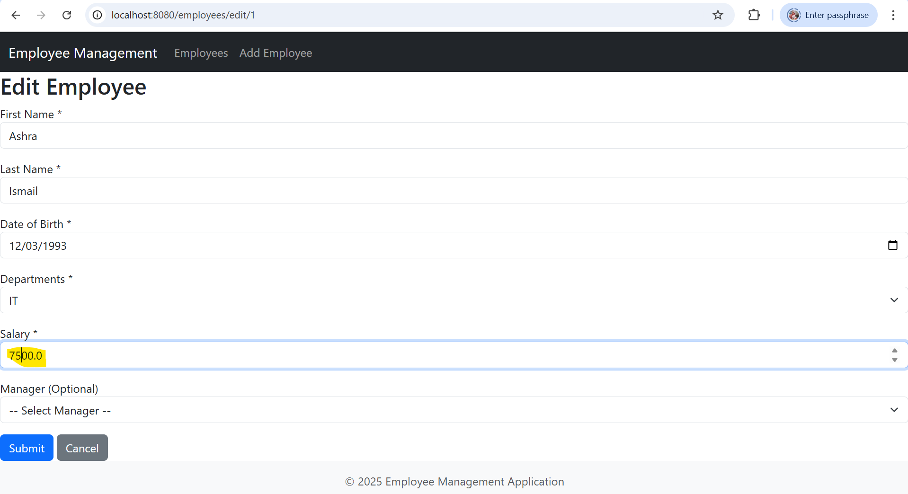

# Spring Boot MVC - Employee Management Application

This Spring Boot MVC application is using:
- JSP with Spring Taglibs
- Tiles layout engine
- H2 in-memory database

## 📝 Description:
- The application has two menus
    - Add employee
    - Employee Listing
- It has a form to add an employee with the below fields
    - First name - required
    - last name - required
    - DOB - required
    - Departments - (fixed drop down) - required
    - Salary - required
    - Manager dropdown - optional field (link to the same table - primary key)
- Added employees to be shown in the next page in a grid - links to edit and view employee

## 🔧 Features

- Add new employee
- List all employees
- View employee details
- Edit existing employee

## 📁 Tech Stack
- **Java (v17)**
- **Maven (v3.9.x+)**
- **Spring Boot (v2.x)**
- **JSP + JSTL + Spring Form Tags**
- **Apache Tiles**
- **H2 Database (with H2 console)**

## 🚀 Endpoints

| Method | URL                     | Description              |
|--------|-------------------------|--------------------------|
| GET    | `/employees/list`       | List all employees       |
| GET    | `/employees/add`        | Show add employee form   |
| POST   | `/employees/save`       | Save employee form data  |
| GET    | `/employees/view/{id}`  | View employee details    |
| GET    | `/employees/edit/{id}`  | Edit employee            |

## 📸 Screenshots

### 1. Home


### 2. Employee List


### 3. Add Employee Form



### 4. View Employee


### 5. Edit Employee


## 🔍 H2 Console

- URL: [http://localhost:8080/h2-console](http://localhost:8080/h2-console)
- JDBC URL: `jdbc:h2:mem:testdb`
- Username: `YOUR_USERNAME`, Password: `YOUR_PASSWORD` (as per your `application.properties`)

---

## 🛠 How to Build and Run
1. **Clone the repository:**
```bash
    git clone https://github.com/ashrashaikh/employee-management.git
```

2. **Change directory to the employee-management repository in your local machine.**
```bash
    cd employee-management
```

3. **Build the application:**
```bash
    mvn clean install
```

4. **Run the application:**
```bash
    mvn spring-boot:run
```

5. **Access the application started on the following URL:**
```
   http://localhost:8080/employees/list
```
